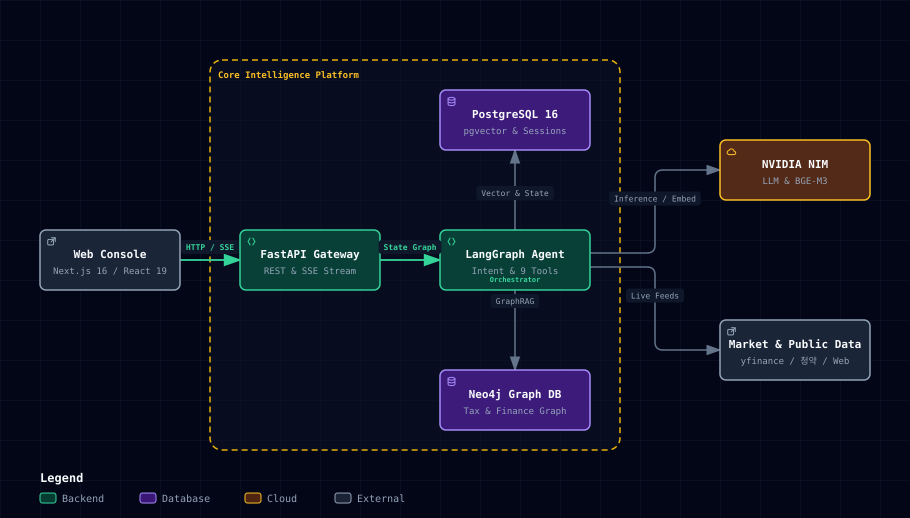

# Midas Touch

[](https://github.com/Jacob-9909/midas-touch/actions/workflows/ci.yml)

근거를 함께 보여주는 AI 금융 상담 서비스입니다. 사기 문자 판정, 세금 계산, 청약 상담을 한 대화에서 처리하고, 답변마다 법령·공고 출처를 붙입니다.

- 데모: https://midas-touch-five.vercel.app (로그인 화면의 "체험 계정으로 바로 시작")
- API: https://midas-touch.duckdns.org/health

> 정보 제공 서비스이며 투자·세무 자문이 아닙니다.

## 주요 기능

| 기능 | 설명 |
|---|---|
| 상담 챗봇 (`/chat`) | LangGraph 에이전트가 질문 의도에 맞는 도구만 실행하고 SSE로 답변을 스트리밍 |
| 사기 문자 검증 (`/security`) | 규칙 기반 판정과 대응 요령, 공식 신고 번호 안내. 프롬프트 인젝션 방어 시연 포함 |
| 세금 계산 | 세율과 공제는 LLM이 아니라 코드가 계산하고, 국세청 해설 조문을 출처로 첨부 |
| 청약 (`/cheongyak`) | 공공데이터 API 공고 조회, 84점 가점 계산, 공고별 당첨 가점 비교 |
| 자금 시뮬레이터 (`/simulator`) | 목표 금액 도달 시점 계산. 자산 정보는 브라우저 안에서만 계산 |
| 지식그래프 (`/graph`) | 세법·청약 문서를 Neo4j 그래프와 pgvector로 색인해 GraphRAG 근거 검색 |

## 아키텍처

<p align="center">
  
</p>

```
Browser ── Vercel (Next.js) ── FastAPI + LangGraph ──┬─ PostgreSQL (pgvector)
                                (Oracle Cloud VM)    └─ Neo4j
```

## 기술 스택

- Frontend: Next.js 16, React 19, TypeScript, Tailwind CSS
- Backend: Python 3.12, FastAPI, LangGraph, Alembic
- Data: PostgreSQL 17 (pgvector), Neo4j 5
- LLM: NVIDIA NIM (`gemma-4-31b-it`, `bge-m3`)
- Infra: Vercel, Oracle Cloud VM (systemd, Caddy), GitHub Actions

## 시작하기

```bash
uv sync
(cd frontend && npm install)
uv run alembic upgrade head
./dev.sh          # backend :8000, frontend :3000
```

환경 변수는 `.env.example`을 참고하세요. 테스트와 린트:

```bash
uv run pytest
uv run ruff check .
```

## 프로젝트 구조

```
backend/     FastAPI 라우터와 LangGraph 에이전트
frontend/    Next.js 웹 콘솔
pipelines/   데이터 수집, 문서 임베딩, 그래프 빌더
shared/      DB 클라이언트, rate limiter
infra/       Caddy, systemd, 자동 배포 스크립트
tests/       pytest
```

## 문서

- [아키텍처](openwiki/architecture.md)
- [에이전트 구조](openwiki/agents.md)
- [API](openwiki/api.md)
- [배포 런북](docs/deploy-runbook.md)
